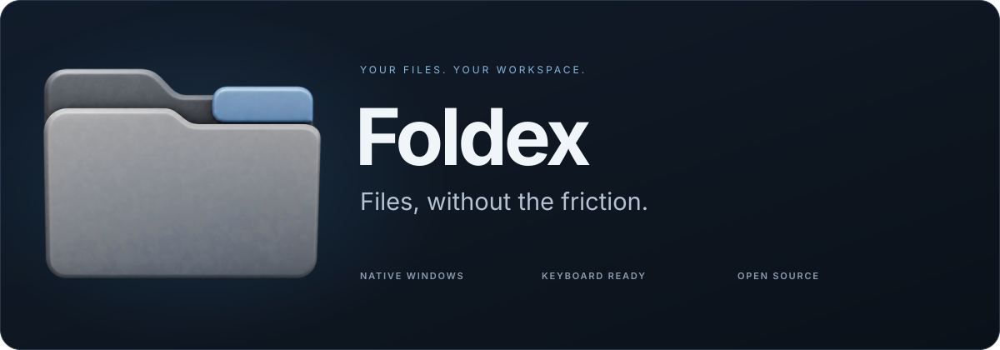

<p align="center">
  
</p>

<p align="center">
  A native Windows file explorer built in Rust.<br />
  Browse in tabs and split panes, find files quickly, and keep your hands on the keyboard.
</p>

<p align="center">
  <a href="#features">Features</a> &nbsp;·&nbsp;
  <a href="#installation">Installation</a> &nbsp;·&nbsp;
  <a href="#keyboard-first">Keyboard</a> &nbsp;·&nbsp;
  <a href="#development">Development</a>
</p>

<p align="center">
  <kbd>Windows x64</kbd> &nbsp; <kbd>Rust 1.95</kbd> &nbsp; <kbd>AGPL-3.0-only</kbd>
</p>

---

## Your files. Your workspace.

Foldex brings everyday file management into a compact, customizable workspace.
Open another tab, split the view, filter a crowded folder, or jump to an app from
the launcher. Native Windows file operations handle the details, while background
workers keep browsing, icons and folder statistics out of the UI thread.

## Features

| | What you can do |
| :--- | :--- |
| **A workspace that fits** | Browse with tabs and split panes. Reorder tabs or move a tab into its own window. Resize panels and keep the Inspector nearby for a closer look. |
| **Find files in context** | Filter the current folder or search its descendants. Use fuzzy filename matching and type filters; see each result's parent path beside its name. |
| **A launcher within reach** | Open apps, recent items and favorites from a global shortcut. Use Shift+Enter to reveal a file in Foldex. Type an equation to calculate, then copy the result. |
| **A useful Home** | Pick up recent work and frequently used files. Filter Recent from the shared bottom bar and switch between detail, list, column and icon views. Keep bookmarks close and choose which sidebar sections and Places appear. |
| **Windows doing Windows things** | Use native Properties, Folder Options, clipboard, drag and drop, New templates, compression and installed context-menu actions. Copy, move, rename and recycle with Windows conflict and progress dialogs. Browse the Recycle Bin, restore items or empty it with confirmation. Undo and redo compatible file operations. |
| **Network when you need it** | Expand Network to see connected shares, connect through Windows dialogs, or browse the native network view. Local browsing does not start network discovery. |
| **Details when you need them** | Choose, reorder and resize columns. Calculate folder sizes and item counts in the background. Toggle file and folder visibility from the footer. |
| **Make it yours** | Choose Dark, Light or System mode. Customize both palettes in a named color scheme, then save, import or export themes. Adjust text size, density, corners, motion and shortcuts in Options. |

### Built to stay responsive

Folder scans, filename indexing, native icons and statistics run on bounded
background workers. Large listings render visible rows rather than creating a
widget for every file. Search publishes paged results, and caches have explicit
limits. Foldex works locally and keeps its theme, session and generated cache
beside the executable.

## Installation

### Portable build

Download the Windows x64 portable ZIP from [GitHub Releases](https://github.com/pfaizar/foldex/releases).
Extract the entire ZIP into a writable folder, then open `Foldex.exe`.
GitHub's **Source code** archives contain source files, not the Windows application.
The initial `0.x` releases are public previews with limited desktop hardware coverage.

**Requires:** Windows x64, a compatible DirectX 12 graphics adapter/driver, and the
[Microsoft Visual C++ x64 Redistributable](https://learn.microsoft.com/en-us/cpp/windows/latest-supported-vc-redist#latest-supported-redistributable-version).

A portable folder contains `Foldex.exe`, the example `theme.toml`, `README.md`,
`LICENSE`, `BUILD-INFO.json`, `THIRD-PARTY-NOTICES.md`, and the `licenses` directory.
The generated `dist` directory is local build output and is not included in Git clones.

The release includes a SHA-256 checksum file for the ZIP. Builds are currently
unsigned, so Windows may display a publisher or SmartScreen prompt.

You can move the portable folder to a writable location of your choice. Preserve
`theme.toml` and `foldex-session.json` when updating to keep your appearance,
bookmarks, workspace and launcher settings.

If **Default File Explorer** is enabled in Options, turn it off before moving or
deleting the portable folder so Windows folder and Win+E registrations are restored.

The launcher shortcut defaults to **Ctrl+Alt+Space**. Closing the browser can keep
Foldex in the system tray; choose **Exit Foldex** from the tray menu to quit, or
turn tray behavior off in Options.

### Build from source

You will need Windows, the Rust toolchain pinned in `rust-toolchain.toml`, and
Visual Studio Build Tools with **Desktop development with C++** and a Windows SDK.

Download or clone the repository, open PowerShell in its root, and run:

```powershell
cargo build --locked --release
.\target\release\foldex.exe
```

The first build downloads the locked dependencies. The default build creates only
the main Foldex application and its required libraries. The Windows icon and
version information are embedded automatically; Python is not needed to build.

To update an existing portable copy after building:

```powershell
Copy-Item -LiteralPath target/release/foldex.exe -Destination dist/Foldex.exe -Force
```

Exit the running app before replacing its executable. Start a fresh portable
folder with the executable, the example `theme.toml`, README, and license notices.
Keep personal sessions, named themes, caches, lock files, and crash logs out of
folders you share with other people. Foldex creates its runtime data as needed.

## Keyboard first

Press **F1** for the full in-app reference. **Tab** moves between controls;
**F6** moves between regions; arrows navigate the focused collection. Start typing
in the file listing to filter immediately. Use
**Shift** to move backward through controls or regions.

| Action | Shortcut |
| :--- | :--- |
| Filter this folder | `Ctrl+F` |
| Expand search into subfolders | `Ctrl+E` |
| Edit the location | `Ctrl+L` |
| Back / forward / parent | `Alt+Left` / `Alt+Right` / `Alt+Up` |
| New / close tab | `Ctrl+T` / `Ctrl+W` |
| Split right / below | `Ctrl+Shift+S` / `Ctrl+S` |
| Open Commands | `Ctrl+Shift+P` |
| Open the launcher | `Ctrl+Alt+Space` |
| Open the focused item's menu | `Shift+F10` |
| Copy / cut / paste | `Ctrl+C` / `Ctrl+X` / `Ctrl+V` |
| Undo / redo file operation | `Ctrl+Z` / `Ctrl+Y` or `Ctrl+Shift+Z` |
| Recycle / permanently delete | `Delete` / `Shift+Delete` (confirmation required) |
| Reveal a launcher result in Foldex | `Shift+Enter` |
| Rename / new folder | `F2` / `Ctrl+Shift+N` |
| Open Options | `Ctrl+,` |

Shortcuts can be changed in Options. Menu navigation, selection, search results,
Home and the launcher support keyboard use throughout.

File-operation history lasts for the current window session. Undo preserves
edited files and refuses occupied restore destinations. Permanent deletion,
overwrites, folder merges and actions performed by external shell extensions
are not reversible through Foldex history.

## Personalization and storage

- **Options:** appearance, shortcuts, launcher settings and Windows integration.
- **`theme.toml`:** an editable theme beside the executable. Reload with `Ctrl+Shift+R`.
- **`themes/`:** your saved and imported color schemes. Each theme contains both dark and light colors. Save and share them from Options.
- **`foldex-session.json`:** saved workspace, bookmarks and preferences.
- **`foldex-cache/`:** generated search data; it can be removed after exiting Foldex.

Optional clipboard history stays in memory while Foldex runs. Clear it or disable
it in Options under Launcher.

## Development

The project is a Cargo workspace. The default renderer uses wgpu with DirectX 12.
The local patches in `vendor/` are required; keep them when building from source.

| Area | Crates |
| :--- | :--- |
| App, launcher and native window integration | `foldex` |
| Shared controls, text, focus and animation | `foldex-ui` |
| Browsing, filesystem and filename search | `foldex-core`, `foldex-fs`, `foldex-index`, `foldex-match` |
| Shell assets, folder statistics and Windows actions | `foldex-assets`, `foldex-folder-stats`, `foldex-shell` |

```powershell
cargo fmt --all -- --check
cargo test --locked --workspace
```

Native Shell and clipboard probes are explicitly ignored because they interact
with Windows. The normal regression suite uses generated fixtures.

An alternative OpenGL build is available for development:

```powershell
cargo build --locked --release -p foldex --no-default-features --features renderer-glow
```

Renderer features are mutually exclusive. Icon exports are committed; see
[the artwork guide](assets/brand/README.md) if you want to regenerate them.
Build output and personal settings are excluded from Git.

CI checks Windows x64 and the website. Version tags build and publish portable
release assets automatically; see [the release guide](docs/RELEASING.md).

## Contributing

Bug reports, focused fixes and usability improvements are welcome. For a bug,
include your Windows version, clear reproduction steps, and the expected result.
A screenshot helps with layout issues. Discuss larger changes before starting
work, and keep pull requests focused enough to review.

## License

Copyright (c) 2026 Foldex contributors.

Foldex is licensed under the [GNU Affero General Public License v3.0 only](LICENSE)
(`AGPL-3.0-only`). Commercial use and forks are allowed under this license.
When redistributing Foldex or a modified version, provide the corresponding source
and preserve the required notices as described in the license. Modified versions
that support remote user interaction must also offer their corresponding source
to those users as required by section 13.

Third-party libraries, fonts, and adapted components retain their upstream
licenses and copyright notices, including the MIT notice in
`crates/foldex-ui/src/rolling.rs`. Vendored dependencies retain their license files
and document local changes in `FOLDEX-PATCH.md`.
